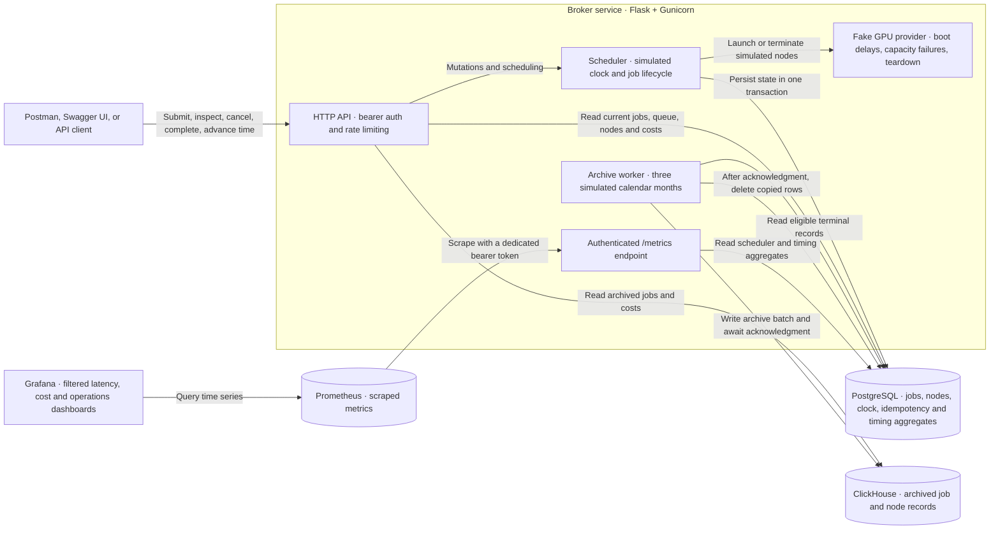
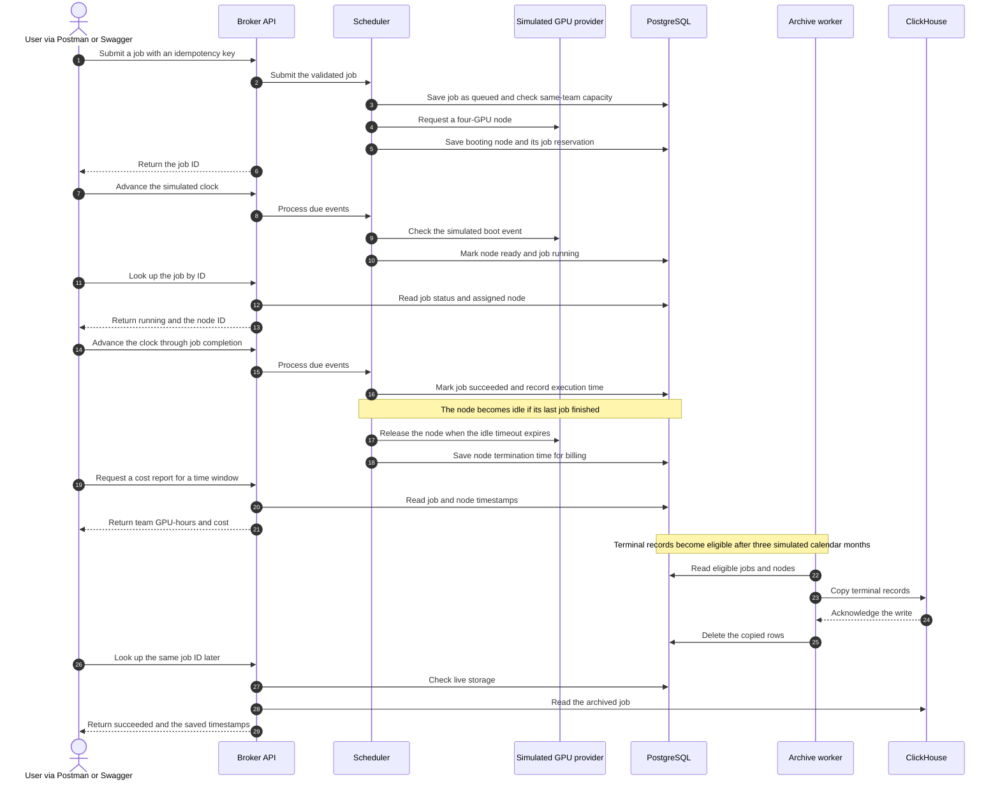

# Shared GPU Job Broker architecture

## System components

## A job from submission to archive

This example follows a two-GPU job that needs a new four-GPU node.

If a ready node already has enough capacity for the team, the scheduler can start the job at submission. If it cannot start the job before its queue deadline, it records a failure with `queue_timeout`.

## Design notes

- **Scheduling.** A PostgreSQL transaction-scoped advisory lock serializes state changes. The scheduler checks same-team GPU capacity, applies queue timeouts, and terminates idle nodes as simulated time advances.
- **Storage.** PostgreSQL holds operational state and derived timing aggregates. The archive worker copies terminal jobs and nodes to ClickHouse before deleting their PostgreSQL rows. Historical API reads combine the two stores when a report spans the retention cutoff.
- **Deployment.** Docker Compose runs the broker and all four dependencies with named volumes for data. The Helm chart deploys the broker and connects it to separately managed data and monitoring services.
- **Trace replay.** The synthetic CSV runs through the same scheduling logic with an isolated SQLite database. It does not write to the live PostgreSQL database.

See the [README](README.md) for deployment commands, configuration, and trace results.
